<!-- BANNER: terminal profile.sh --live. Regenerate with: python scripts/generate.py -->
<a href="https://adityagis.github.io/Portfolio/">
<picture>
  <source media="(prefers-color-scheme: dark)"  srcset="assets/banner-dark.svg">
  <source media="(prefers-color-scheme: light)" srcset="assets/banner-light.svg">
  
</picture>
</a>

 

 

&nbsp;&nbsp;
&nbsp;&nbsp;
&nbsp;&nbsp;

 

---

# Aditya Kumar Jha — Geoinformatics, GNSS and Geodesy

[Explore my geoinformatics and geodesy expertise guide](https://adityagis.github.io/Portfolio/pages/notes/geoinformatics-geodesy.html): GNSS CORS processing, high precision levelling, Python GIS automation, LiDAR, remote sensing and GeoAI, with links to project case studies.

## Hi, I'm Aditya 👋

I'm **Aditya Kumar Jha**, a **GIS engineer** at **Survey of India** (Geodetic & Research Branch, Dehradun). I work where geodesy meets code: I take raw spatial data and automate everything between the data and the decision.

- 🛰️ **GNSS & geodesy:** I process GNSS CORS data from **1023+ reference stations** with GAMIT/GLOBK and PRIDE PPP-AR, and High Precision Levelling data for India's national vertical datum.
- 🐍 **Python automation:** my scripts cut GNSS processing from **7 days to 3 days per station**, and a month of levelling analysis to **one day**, with QA/QC (Tau test, global statistical validation) built in.
- 🌊 **LiDAR & remote sensing:** at **DRDO** (DGRE, Chandigarh) I analysed ~3 million LiDAR points and 32 hyperspectral bands for flood inundation and terrain vulnerability models.
- 🧭 **Consulting Head at Uday GeoAnalytics Consultancy:** building GeoAI products for India: rooftop solar, village flood alerts, land use classification, borewell prediction and land records on WhatsApp.
- 🎓 B.Tech in **GeoInformatics** from **NSUT Delhi** (2025). Founded the NSUT Geospatial Technology Club (200+ members).
- 🤝 Open to **research roles, geospatial consulting and startups** working on hard spatial problems. [Get in touch →](https://adityagis.github.io/Portfolio/pages/contact.html)

## Selected work

| Project | What it does | Stack |
| --- | --- | --- |
| [**GNSS CORS processing**](https://adityagis.github.io/Portfolio/pages/project/gnss-cors.html) | Pipelines for 1023+ Survey of India reference stations, centimeter-level accuracy | Python · GAMIT/GLOBK · PRIDE PPP-AR · RINEX |
| [**High Precision Levelling**](https://adityagis.github.io/Portfolio/pages/project/hpl.html) | Height datum computation, loop closure and error correction | Python · Geodesy · QA/QC |
| [**SolarSight**](https://adityagis.github.io/Portfolio/pages/project/solarsight.html) | Rooftop solar assessment for Indian homes, 7-page PDF report in under 2 minutes | GIS · NASA solar data · PDF reports |
| [**Baadh Mitra**](https://adityagis.github.io/Portfolio/pages/project/baadh-mitra.html) | Flood early warning for villages, AI-written alerts on WhatsApp | Weather + flood forecast data · AI alerts · WhatsApp |
| [**UGD LULC Engine**](https://adityagis.github.io/Portfolio/pages/project/ugd-lulc.html) | Land use / land cover classification for India, 98.1% validation accuracy | Python · PyTorch · EuroSAT · QGIS |
| [**Kuaan Mitra**](https://adityagis.github.io/Portfolio/pages/project/kuaan-mitra.html) | Borewell success predictor for farmers and groundwater planners | GeoAI · Hydrogeology · Remote sensing |
| [**LiDAR & hyperspectral (DRDO)**](https://adityagis.github.io/Portfolio/pages/project/lidar.html) | ~3M-point LiDAR cloud and hyperspectral cleaning and analysis | Python · laspy · Spectral Python |
| [**Flood risk mapping (DRDO)**](https://adityagis.github.io/Portfolio/pages/project/flood-risk.html) | Areas flooded under 1 m sea level rise | QGIS · DEM · Spatial analysis |

<a href="https://adityagis.github.io/Portfolio/pages/projects.html">See all projects on my portfolio →</a>

---

## My stack

  

---

## Numbers matter

<picture>
  <source media="(prefers-color-scheme: dark)"  srcset="assets/numbers-dark.svg">
  <source media="(prefers-color-scheme: light)" srcset="assets/numbers-light.svg">
  
</picture>

---

`Maps. People. Possibilities.` · <a href="https://adityagis.github.io/Portfolio/">adityagis.github.io/Portfolio</a> · Dehradun, India

